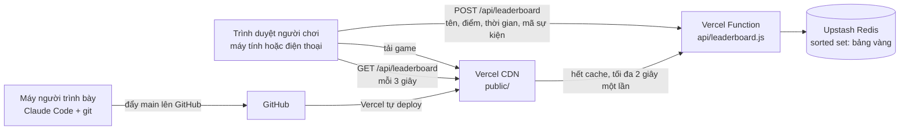
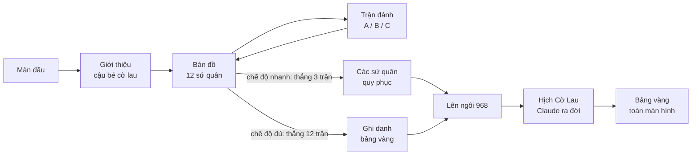

# Cờ Lau Đi — Kiến trúc

| Mục | Nội dung |
| --- | --- |
| Ngày cập nhật | 13/10/2026 |
| Chi phí hạ tầng | 0 đồng |
| Liên quan | [01 Yêu cầu](01-yeu-cau.md) · [02 Hỏi đáp](02-hoi-dap.md) (Q-13, Q-15, Q-16) |

Game là một trang tĩnh. Chỉ bảng vàng (bảng xếp hạng chung) cần phía server, gồm **một Vercel Function** và **một sorted set trong Upstash Redis**. Không framework, không bước build.

## 1. Sơ đồ tổng thể



## 2. Thành phần

| File | Vai trò |
| --- | --- |
| `public/index.html` | Khung trang, toàn bộ CSS |
| `public/game.js` | Nội dung 12 sứ quân, các màn, âm thanh, cờ lau, ấn son, phần bảng vàng phía trình duyệt |
| `public/sound/` | 7 mẫu âm thanh MP3 (trống taiko, chiêng, tù và), tổng cộng dưới 1 MB; nguồn và giấy phép CC0 trong `LICENSES.md` |
| `public/score.js` | Luật tính điểm: hàm thuần, dùng chung cho trình duyệt và server |
| `api/leaderboard.js` | API bảng vàng; dùng Upstash Redis nếu có biến môi trường, nếu không thì lưu trong bộ nhớ |
| `scripts/dev.mjs` | Server chạy thử ở máy, không cần cài thư viện |
| `tests/` | Kiểm thử đơn vị và API (Vitest) |
| `e2e/` | Kiểm thử đầu cuối trên trình duyệt (Playwright) |
| `vercel.json` | Cấu hình deploy: phục vụ thư mục `public/`, không build, không cài thư viện |

Âm thanh (FR-18): khối `sound` trong `game.js` tải 7 mẫu bằng `fetch` + `decodeAudioData` ngay khi mở trang (người chơi tải sau lần hỏi bảng vàng đầu tiên), rồi phát các cue ngắn qua `sfx.cue(tên)`; không có nhịp nền hay vòng lặp. Mỗi cảnh có một nút gain riêng: `go()` làm nhỏ dần 150 ms và dừng mọi nguồn âm của cảnh cũ; ở màn đăng quang và đoạn kết, mỗi bước là một nhóm riêng nên Enter bỏ qua bước thì trống bước trước dừng, còn chiêng chỉ có một tiếng tại một lúc. Nếu một mẫu lỗi, mọi cue chuyển sang bộ tổng hợp Web Audio và nút ghi "Âm thanh: bản tổng hợp (mẫu lỗi) · bấm để tải lại". Tab ẩn thì tắt dần và `suspend()`. Trạng thái tắt tiếng lưu trong `localStorage`. Chi tiết: [09 Sound plan](09-sound-plan.md).

## 3. Các màn trong game



## 4. Luật tính điểm

| Tình huống trong một trận | Điểm |
| --- | --- |
| Đúng ngay lần đầu | 3 |
| Sai một lần rồi đúng | 1 |
| Sai hai lần rồi đúng | 0 |

- Tối đa 36 điểm cho 12 trận.
- Xếp hạng: nhiều điểm hơn đứng trên; bằng điểm thì ai hoàn thành nhanh hơn đứng trên.
- Giá trị xếp hạng = điểm × 100.000 + (99.999 − số giây). Một con số duy nhất thể hiện cả điểm lẫn thời gian, nên Redis tự sắp xếp đúng.

## 5. API bảng vàng

### `GET /api/leaderboard`

Trả về 10 người dẫn đầu. CDN giữ kết quả 2 giây (`Cache-Control: s-maxage=2, stale-while-revalidate=2`).

```json
{ "top": [{ "rank": 1, "id": "…", "name": "Lan Anh QA", "points": 33, "timeSec": 412 }], "total": 5, "codeRequired": true, "store": "redis" }
```

### `POST /api/leaderboard`

Bắt đầu lượt chơi (khi người chơi bấm "Đánh đủ 12 trận"): `{ "action": "start", "runId": "…" }` → server ghi lại giờ bắt đầu.

Ghi danh: `{ "name": "…", "points": 30, "runId": "…", "code": "…" }`. Thời gian do server tự tính từ giờ bắt đầu; thời gian trình duyệt gửi lên bị bỏ qua.

Ban tổ chức (header `x-admin-key`): `{ "action": "close" }` khoá sổ, `{ "action": "open" }` mở lại.

| Kiểm tra phía server | Khi sai |
| --- | --- |
| Tên: bỏ ký tự điều khiển, gộp khoảng trắng, cắt còn 20 ký tự, không được rỗng | 400 "Hãy nhập tên (tối đa 20 ký tự)." |
| Điểm: số nguyên từ 0 đến 36 | 400 "Điểm không hợp lệ." |
| Có giờ bắt đầu do server ghi | 400 "Không tìm thấy lượt chơi trên máy chủ. Hãy chơi lại từ đầu." |
| Thời gian server đo: từ `MIN_RUN_SEC` (mặc định 45 giây) đến 2 giờ | 400 "Thời gian không hợp lệ." |
| Tối đa 40 lần gửi mỗi IP mỗi 10 phút | 429 "Gửi quá nhiều lần. Chờ vài phút rồi thử lại." |
| Bảng vàng chưa khoá sổ | 403 "Bảng vàng đã khoá sổ." |
| Mã lượt chơi: 8–40 ký tự chữ, số, gạch nối | 400 "Lượt chơi không hợp lệ." |
| Mã sự kiện (chỉ khi đặt `EVENT_CODE`), không phân biệt hoa thường | 403 "Sai mã sự kiện. Mã được chiếu trong buổi họp." |
| Mỗi lượt chơi chỉ ghi danh một lần | 409 "Lượt chơi này đã được ghi danh." |

Thành công: `201 { "rank": 3, "total": 57, "name": "…", "timeSec": 412 }`

### `DELETE /api/leaderboard`

Chỉ ban tổ chức, gửi header `x-admin-key` khớp biến `ADMIN_KEY`.

- `?id=<mã lượt chơi>`: xoá một lượt.
- `?name=<tên>`: xoá mọi lượt mang tên này.
- `?all=1`: xoá trắng bảng vàng (dùng sau buổi chạy thử).

## 6. Dữ liệu trong Redis

| Khoá | Kiểu | Nội dung |
| --- | --- | --- |
Mọi khoá có tiền tố môi trường `colaudi:<production|preview|local>:`, nên điểm chạy thử không lẫn vào bảng vàng thật.

| Khoá (sau tiền tố) | Kiểu | Nội dung |
| --- | --- | --- |
| `leaderboard` | Sorted set | Mỗi phần tử là chuỗi JSON `{id, n: tên, p: điểm, t: giây}`; điểm số là giá trị xếp hạng ở mục 4, cộng một phần lẻ để ai gửi trước đứng trên khi bằng điểm và bằng giây |
| `start:<mã lượt>` | Chuỗi, hết hạn sau 2 giờ | Giờ bắt đầu do server ghi |
| `done:<mã lượt>` | Chuỗi, hết hạn sau 24 giờ | Đánh dấu lượt đã ghi danh |
| `rate:<IP>` | Số đếm, hết hạn sau 10 phút | Số lần gửi gần đây |
| `closed` | Chuỗi | Có mặt nghĩa là đã khoá sổ |

## 7. Bảng vàng phía trình duyệt

- Khi mở màn ghi danh hoặc màn bảng vàng, trình duyệt gọi `GET` mỗi 3 giây và vẽ lại 10 dòng.
- Nếu không gọi được API (ví dụ bản xem thử trên claude.ai, hoặc mở file trực tiếp), game tự chuyển sang lưu trên trình duyệt và ghi rõ "Bản xem thử: chỉ lưu trên trình duyệt này".
- Tên và mã sự kiện đã nhập được nhớ lại cho lần sau. Mã sự kiện cũng có thể đưa sẵn qua đường link `?code=…`.

## 8. Biến môi trường

| Biến | Bắt buộc | Ý nghĩa |
| --- | --- | --- |
| `KV_REST_API_URL`, `KV_REST_API_TOKEN` | Khi deploy | Do Vercel tự thêm khi kết nối Upstash Redis; chấp nhận cả `UPSTASH_REDIS_REST_URL`, `UPSTASH_REDIS_REST_TOKEN` |
| `EVENT_CODE` | Không | Mã sự kiện; bỏ trống thì không yêu cầu |
| `ADMIN_KEY` | Không | Khoá quản trị để xoá tên |

## 9. Quyết định kiến trúc

### ADR-01 · Vercel Hobby + Upstash Redis cho bảng vàng

- **Bối cảnh:** game là trang tĩnh; chỉ bảng vàng chung cho hơn 100 người cần lưu ở server. Đây là demo cá nhân, phi thương mại.
- **Quyết định:** một Vercel Function và một sorted set trong Upstash Redis.
- **Lý do:** sorted set chính là bảng xếp hạng (ghi điểm một lệnh, lấy top 10 một lệnh), không cần schema. Gói Hobby của Vercel dành cho dự án cá nhân, phi thương mại. Upstash miễn phí 500.000 lệnh mỗi tháng.
- **Phương án đã loại:** bảng điểm riêng từng máy (mất thi đua chung); Artifact có cơ sở dữ liệu chung (người chơi phải có tài khoản trong tổ chức); Firebase hoặc Supabase gọi thẳng từ trình duyệt (không kiểm tra được điểm). Cloudflare Workers + D1 được giữ làm dự phòng nếu mạng công ty chặn `vercel.app`.
- **Lịch sử:** kế hoạch ban đầu chọn Cloudflare vì lo gói Vercel miễn phí không cho dùng thương mại. Khi Thông xác nhận đây là demo, không thương mại, quyết định đổi sang Vercel (Q-15).

### ADR-02 · HTML, CSS, JS thuần, không framework, không bước build

Khán giả đọc được code trên màn chiếu; deploy mất vài giây; Claude sửa trực tiếp một file trong phần demo.

### ADR-03 · Hỏi lại server mỗi 3 giây, CDN giữ kết quả 2 giây

100 người hỏi mỗi 3 giây phần lớn được CDN trả lời; phần lọt qua CDN được bộ nhớ của function giữ thêm 2 giây; GET có tham số bị từ chối để không ai vượt được cache. Không dùng WebSocket để tránh rủi ro khi demo trực tiếp.

### ADR-04 · Mã sự kiện thay cho đăng nhập

Game không chứa dữ liệu nhạy cảm, nên một mã chỉ chiếu trong buổi họp là đủ để chặn người ngoài ghi danh.

### ADR-05 · Luật tính điểm là hàm thuần dùng chung

`public/score.js` chạy được cả ở trình duyệt lẫn server, nên kiểm thử đơn vị trực tiếp được, và hai phía không bao giờ tính khác nhau.

### ADR-07 · Server tự đo thời gian, không tin trình duyệt

Nhiều người sẽ đạt 36 điểm, nên thời gian quyết định thứ hạng. Server ghi giờ bắt đầu mỗi lượt và tự tính thời gian lúc ghi danh, kèm giới hạn số lần gửi theo IP. Điểm vẫn có thể bị làm giả vì đáp án nằm trong trình duyệt; co-host kiểm tra top 3 trước khi xướng danh (red-team H1, H2).

### ADR-08 · Không deploy production trên sân khấu

Production chỉ thay đổi khi Thông đẩy `main`; Claude Code bị chặn `vercel --prod` trong `.claude/settings.json` (red-team C2).

### ADR-06 · Không dùng logo nhãn hiệu Claude

Logo Claude là nhãn hiệu của Anthropic. Ấn son trên chiếu thư là thiết kế riêng, khắc "CLAU / DE" theo câu chơi chữ Cờ Lau Đi → Claude (Q-23).

## 10. Chạy thử, kiểm thử, deploy

```bash
npm run dev          # http://localhost:3000, bảng vàng lưu trong bộ nhớ
npm install          # chỉ cần khi chạy kiểm thử
npm test             # 28 kiểm thử đơn vị và API
npm run test:e2e     # 5 kiểm thử đầu cuối
npm run smoke -- <url> --write          # kiểm tra nhanh một bản deploy
npm run board -- <url> top|wipe|rm "<tên>"|close|open   # lệnh ban tổ chức (ADMIN_KEY lấy từ biến môi trường)
```

Production chỉ thay đổi khi đẩy `main` lên GitHub. Các bước deploy lần đầu: [07 Deployment plan](07-deployment.md).
