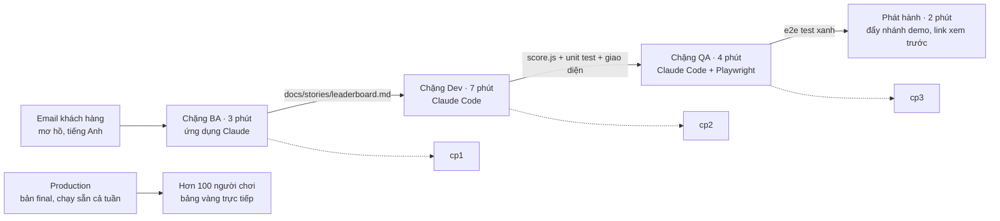

# Kế hoạch buổi thuyết trình và live demo

| Mục | Nội dung |
| --- | --- |
| Ngày cập nhật | 13/10/2026, sau red-team review ([08](08-red-team-review.md)) |
| Buổi họp | 30 phút trình bày + 30 phút hỏi đáp, Google Meet, hơn 100 người, nói tiếng Việt, slide tiếng Anh |
| Liên quan | [02 Hỏi đáp](02-hoi-dap.md) Q-09 đến Q-14 · [05 Tổ chức Google Meet](05-to-chuc-google-meet.md) · [06 Kịch bản](06-kich-ban-va-hoi-dap-khan-gia.md) |

Slide 9 phút, live demo 16 phút, phần game mở và kết 3,5 phút. Khán giả chơi game trong 5 phút đầu của phần hỏi đáp.

## 1. Mục tiêu

1. Dev, BA và QA đều thấy Claude giúp mình ở đâu.
2. Khán giả thấy một quy trình liền mạch: email khách hàng mơ hồ → user story → code có test → kiểm thử tự động → deploy.
3. Mỗi người rời buổi với một việc cụ thể để thử trong tuần.

## 2. Những điều chỉnh để bảo vệ kết quả (Q-14)

**Nguyên tắc sau red-team review:** production chỉ thay đổi khi Thông đẩy `main`; không deploy gì trên sân khấu. Production chạy bản `final` cả tuần, nên phần demo có trục trặc thì khán giả vẫn chơi được.

1. Demo bắt đầu từ một **email khách hàng mơ hồ bằng tiếng Anh**, để BA và QA không thấy đây chỉ là trò chơi.
2. Mỗi chặng demo có **giới hạn thời gian và điểm lưu** dựng sẵn.
3. ~~Game mở màn rút còn 2 trận~~ Từ 14/10 game không còn chế độ nhanh: phải dẹp đủ **12 trận** mới tới màn đăng cơ (Q-31). Xem ghi chú ⚠ ở mục 3.
4. Slide nghiêng về Dev (2 slide Dev, 1 BA, 1 QA); phần demo cân bằng ba vai trò.
5. **Khán giả chơi chính tính năng vừa được xây** ngay đầu phần hỏi đáp.

## 3. Lịch chạy chương trình

| Thời gian | Phần | Trên màn hình | Giới hạn cứng |
| --- | --- | --- | --- |
| 0:00–2:00 (cần xếp lại, xem ⚠ dưới bảng) | Mở màn: chiến dịch 12 trận, khán giả bỏ phiếu A/B/C trong chat | Game | Chưa chốt |
| 2:00–11:00 | Slide 1–9 | Claude Slides | 11:30 |
| 11:00–14:00 | Demo chặng 1: BA | Ứng dụng Claude | Sau 14:30 nhảy tới điểm lưu `cp1` |
| 14:00–21:00 | Demo chặng 2: Dev | Claude Code trong terminal + game trên trình duyệt | Sau 21:30 nhảy tới `cp2` |
| 21:00–25:00 | Demo chặng 3: QA | Claude Code + Playwright | Sau 25:30 nhảy tới `cp3` |
| 25:00–27:00 | Đẩy nhánh demo lên GitHub (CI chạy, Vercel tạo link xem trước). Co-host xoá trắng bảng vàng production rồi đưa link production và mã sự kiện vào chat Meet | Terminal, rồi bảng vàng | Production đã chạy sẵn bản `final`, không deploy gì trên sân khấu |
| 27:00–28:30 | Slide 10: mỗi vai trò làm gì trong tuần này | Slide | — |
| 28:30–30:00 | Kết: bảng điểm (Enter), đăng cơ 968, Hịch Cờ Lau, "Claude" | Game | — |
| 30:00–35:00 | Khán giả chơi chế độ đủ 12 trận; bắt đầu hỏi đáp | Bảng vàng trực tiếp (phím `L`) | — |
| 35:00–58:00 | Hỏi đáp theo nhóm chủ đề | Slide 11 làm nền | — |
| 58:00–60:00 | Xướng danh 3 người đứng đầu bảng vàng | Bảng vàng | — |

Co-host giữ giờ và báo hiệu trong chat khi tới mỗi giới hạn cứng, để người trình bày không phải tự xem đồng hồ.

> **⚠ Thời lượng: 12 trận trên sân khấu.** Lịch trên viết cho bản có chế độ nhanh (2 trận trong 2 phút). Từ 14/10 màn đăng cơ chỉ mở sau 12 trận. Ước tính từ kịch bản ([06](06-kich-ban-va-hoi-dap-khan-gia.md) mục 1: 2 trận cùng lời dẫn gói trong 2:00): mỗi trận khoảng 50 giây (bỏ phiếu 20 giây, đọc kết quả chat, tiếng hô, câu "Chiêu Claude", chuyển về bản đồ). 12 trận khoảng 10 phút, cộng lời dẫn đầu và bảng điểm khoảng 1 phút. Phần game mở và kết từ 3,5 phút thành khoảng 13 đến 14 phút, **thêm khoảng 10 đến 11 phút** vào chương trình 30 phút trình bày. Chưa xếp lại lịch; việc chờ Thông quyết: (a) cắt thời gian bỏ phiếu mỗi trận còn 10 giây, thành khoảng 6 phút; (b) chia 12 trận vào nhiều chỗ (vài trận mở màn, phần còn lại xen giữa các chặng demo, trận cuối trước phần kết); (c) rút bớt slide; (d) cho khán giả tự chơi từ trước và người trình bày chỉ mở lại phần đã chơi.

## 4. Dàn ý slide (slide tiếng Anh)

| # | Tiêu đề | Ý chính | Hình |
| --- | --- | --- | --- |
| 1 | “Cờ Lau” đi: Claude for Dev, BA & QA | “Cờ Lau” là tiếng lóng chỉ Claude (đọc nhanh nghe như "Claude"); “đi” là lời rủ dùng Claude | Cờ lau + tiêu đề |
| 2 | From autocomplete to teammate | Ba mức: gợi ý code, chat, agent. Lợi ích lớn nằm ở mức 3 | Bậc thang 3 bước |
| 3 | An agent is only as good as its check | Vòng lặp: tìm hiểu → lên kế hoạch → làm → kiểm tra. Không có cách kiểm tra thì không giao việc được | Sơ đồ vòng lặp |
| 4 | One Claude, three doors | Ứng dụng Claude để suy nghĩ và viết tài liệu, Claude Code để làm việc với repo, API để xây sản phẩm | 3 cánh cửa |
| 5 | Dev: explore → plan → build → verify → review | Plan mode trước; test là định nghĩa của "xong" | Dải quy trình |
| 6 | Dev: context is the lever | CLAUDE.md luôn bật, skill khi cần, hook luôn chạy, subagent cho đầu óc sạch, MCP cho công cụ ngoài repo | 5 ô, mỗi ô một quy tắc |
| 7 | BA: from a vague email to a testable story | Câu hỏi làm rõ, user story, tiêu chí chấp nhận, sơ đồ, tài liệu chia sẻ được | Trước / sau: email → story |
| 8 | QA: from acceptance criteria to tests | Thiết kế test từ tiêu chí chấp nhận, tự động hoá, khám phá trên trình duyệt, review code nhiều agent | Tiêu chí → test case → chạy xanh |
| 9 | One feature, three roles, live | Bàn giao: `story.md` → code + unit test → e2e test → deploy | Sơ đồ bàn giao (dẫn vào demo) |
| 10 | What to try this week | Dev viết một CLAUDE.md; BA biến một email thành story; QA sinh test từ một story | 3 cột |
| 11 | Play, then ask | Link game, mã sự kiện, các chủ đề hỏi đáp | Bảng vàng |

**Câu nói về an toàn (nói ở slide 9, không làm slide riêng):** mã nguồn và dữ liệu khách hàng tuân theo hợp đồng với khách hàng; kiểm tra trước khi đưa bất kỳ công cụ AI nào vào repo của khách. Con người review mọi thứ trước khi merge.

## 5. Live demo BA → Dev → QA

**Điểm xuất phát (`cp0`):** game bản đầy đủ, chỉ có **luật tính điểm để trống** (`pointsFor` luôn trả 0) và chưa có test cho luật này; giao diện bảng vàng và API đã chạy sẵn; thư mục `docs/stories/` trống. Nói thẳng với khán giả: "giao diện và backend đã dựng sẵn, hôm nay mình làm phần luật tính điểm, đúng quy trình". (Theo red-team H4: bỏ hẳn tính điểm và bảng vàng ở `cp0` sẽ làm backend lỗi, và xây lại tất cả trong 7 phút là không thực tế.)

**Email khách hàng (đầu vào cho chặng BA):**

> Hi team, our players love the game but they want to compete with each other. Can we add some kind of points and a ranking? It should be fun and fair. We'd like it before our company event. Thanks, Linh

| Chặng | Người trình bày gõ | Khán giả thấy | Kết thúc ở |
| --- | --- | --- | --- |
| BA | "Đây là email khách hàng. Liệt kê những điểm còn mơ hồ, đề xuất câu trả lời hợp lý, rồi viết user story và acceptance criteria dạng Given/When/Then." | Claude hỏi "công bằng" nghĩa là gì, đề xuất luật 3/1/0 và cách xử lý bằng điểm, viết story | `leaderboard.md` lưu vào repo → `cp1` |
| Dev | Plan mode: "Đọc docs/stories/leaderboard.md và lên kế hoạch cho luật tính điểm." Sau đó: "Làm theo kế hoạch. Viết tests/score.test.js trước, rồi sửa pointsFor, chạy npm test đến khi xanh." | Kế hoạch được duyệt, test đỏ, rồi xanh, rồi điểm hiện đúng trong game | Unit test xanh, commit → `cp2` |
| QA | "Từ acceptance criteria trong story, liệt kê test case, rồi viết Playwright test cho 3 case quan trọng nhất và chạy." | Bảng test case, rồi trình duyệt chạy tự động và chuyển xanh | e2e xanh, commit → `cp3` |
| Phát hành | `git push origin demo`: GitHub Actions chạy test, Vercel tạo link xem trước. Nói: "trong dự án thật, nhánh này được review rồi mới merge". Không deploy production trên sân khấu | CI xanh, có link xem trước | Co-host đưa link production và mã sự kiện vào chat; khán giả chơi |

**Câu nói trong lúc demo:**

- Chặng BA: "Claude không đoán thay khách hàng. Nó liệt kê điểm mơ hồ để BA hỏi lại. Đó mới là phần giá trị."
- Chặng Dev: "Mình không gõ code. Mình duyệt kế hoạch và đọc test."
- Chặng QA: "Acceptance criteria của BA biến thành test chạy được. Story, code, test nằm cùng một repo."

**Đáp án mẫu:** phiên bản đầy đủ hiện tại của repo chính là kết quả mong đợi sau chặng QA. User story mẫu nằm ở US-01 trong [01 Yêu cầu](01-yeu-cau.md).

## 6. Kế hoạch làm việc

| # | Gói việc | Người làm | Xong khi | Trạng thái |
| --- | --- | --- | --- | --- |
| 1 | Repo, API bảng vàng, Redis, mã sự kiện | Claude | API trả lời trên link thật | Code xong, đã qua red-team review; chờ Thông đẩy lên GitHub |
| 2 | Game bản đầy đủ: tính điểm, bảng vàng, đăng cơ 968, Hịch Cờ Lau, cờ lau mới | Claude | Chạy trên link thật | Xong; 25 kiểm thử chạy qua |
| 3 | Tạo `cp0`: luật tính điểm để trống, bỏ test của luật này | Claude | `cp0` chạy được, gắn tag | Thứ Tư 14/10 |
| 4 | Slide 1–11 bằng Claude Slides, tiếng Anh | Claude, Thông duyệt | Thông duyệt | Chưa làm |
| 5 | Kịch bản lời nói tiếng Việt | Claude, Thông duyệt | Thông duyệt | Có bản đầu: [06 Kịch bản](06-kich-ban-va-hoi-dap-khan-gia.md) |
| 6 | Chạy thử 1: chạy cả phần demo bằng Claude Code, gắn tag `cp1`–`cp3`, quay video dự phòng, đặt `MIN_RUN_SEC` theo lượt chơi thật nhanh nhất | Claude + Thông | Có 3 tag, link dự phòng chạy, có video | Chưa làm |
| 7 | Hậu cần: phòng A + phòng B, co-host, người vận hành, mã sự kiện, quy tắc bỏ phiếu | Thông | Đã có tên người và lịch | Chưa làm |
| 8 | Chạy thử 2: đủ 30 phút qua phòng relay với 3 người, rồi đưa repo về `cp0` và xoá trắng bảng vàng | Thông + co-host + người vận hành | Dưới 30 phút; bảng vàng cập nhật ở phòng B | Chưa làm |
| 9 | Deploy lần đầu: đẩy GitHub, nối Vercel, thêm Redis và biến môi trường | Thông, theo [07 Deployment plan](07-deployment.md) mục 4 | Smoke test qua trên production | Thứ Ba 13/10 |

**Sáng ngày thuyết trình:** kéo repo mới nhất; khởi động Claude Code bằng một câu lệnh thử; mở sẵn các tab theo thứ tự (game, slide, ứng dụng Claude, terminal); kiểm tra link dự phòng; cắm dây mạng.

## 7. Rủi ro và phương án dự phòng

| Rủi ro | Khả năng | Dự phòng |
| --- | --- | --- |
| Một chặng demo chạy quá giờ | Cao | `git checkout cp1`/`cp2`/`cp3`, nói "phần này mình đã chạy sẵn", đi tiếp |
| Claude trả lời khác với lúc chạy thử | Cao | Bình thường; câu lệnh cố định, quy trình mới là điểm chính. Nếu kết quả sai, đó chính là lúc review: cho khán giả xem, rồi nhảy tới điểm lưu |
| Hết hạn mức sử dụng Claude giữa buổi | Thấp | Dùng gói có dư hạn mức trong ngày; có video dự phòng |
| Người trình bày rớt mạng | Thấp | Dây mạng + điện thoại phát wifi; co-host giữ phòng A |
| Đẩy nhánh demo thất bại | Thấp | Không ảnh hưởng khán giả: production chạy sẵn bản `final` |
| Điểm giả bằng curl | Trung bình | Server tự đo thời gian từ lúc bắt đầu, giới hạn số lần gửi; co-host kiểm tra top 3 trước khi xướng danh |
| Người chơi trước giờ làm bẩn bảng vàng | Trung bình | Co-host xoá trắng bảng vàng lúc 25:00, ngay trước khi đưa link |
| Mạng công ty chặn `vercel.app` | Thấp | Kiểm tra ở chạy thử 2; nếu bị chặn, deploy sang Cloudflare Workers |
| Tên không phù hợp trên bảng vàng | Trung bình | Người điều phối xoá bằng một lệnh; tên tối đa 20 ký tự |
| Vượt hạn mức miễn phí | Rất thấp | CDN và bộ nhớ của function giữ kết quả 2 giây; chặn tham số lạ trên GET; giới hạn số lần gửi theo IP; hạn mức 500.000 lệnh mỗi tháng |
| Upstash xoá cơ sở dữ liệu vì không dùng | Thấp | Tạo trước một tuần qua Vercel Marketplace; dùng trong các buổi chạy thử |
| Chữ khó đọc qua phòng relay | Trung bình | Cỡ chữ 20pt; phóng to trình duyệt 125% |

## 8. Việc còn mở cho Thông

| Mã | Việc |
| --- | --- |
| V-01 | Ngày thuyết trình: **đã chốt Thứ Sáu 16/10/2026**; lịch theo ngày ở [07 Deployment plan](07-deployment.md) |
| V-02 | Công ty đã cấp Claude cho nhân viên chưa; quyết định slide 10 là "dùng ngay từ mai" hay "đề xuất triển khai" |
| V-03 | Tên co-host (giữ giờ, đọc chat, hỏi đáp) và người vận hành phòng B |
| V-04 | Đồng ý chạy game trên link công khai có mã sự kiện chỉ chiếu trong buổi họp; game không chứa dữ liệu công ty hay khách hàng |
| V-05 | Phần thưởng nhỏ cho 3 người đứng đầu bảng vàng (không bắt buộc, nhưng tăng mạnh mức tham gia) |
| V-06 | Deploy lần đầu theo [07 Deployment plan](07-deployment.md) mục 4 (Thứ Ba 13/10) |
