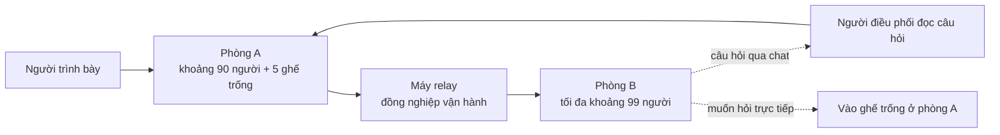

# Tổ chức buổi họp trên Google Meet cho hơn 100 người

| Mục | Nội dung |
| --- | --- |
| Ngày cập nhật | 13/10/2026 |
| Liên quan | [02 Hỏi đáp](02-hoi-dap.md) Q-02 đến Q-06 · [04 Kế hoạch](04-ke-hoach.md) |

Công ty chỉ có gói Google Meet tối đa 100 người, buổi họp có hơn 100 người, phải hoàn toàn online, chỉ một buổi, tương tác được và không chia sẻ ra ngoài công ty. Phương án đã chốt: **phòng chính A và phòng relay B**.

## 1. Các ràng buộc

| Ràng buộc | Nguồn |
| --- | --- |
| Gói Meet tối đa 100 người mỗi cuộc họp | Q-03 |
| Không chia sẻ ra ngoài công ty, nên không phát lên YouTube hay nền tảng công khai | Q-03 |
| Toàn bộ online, không gom người ở phòng họp | Q-04 |
| Một buổi duy nhất, phải tương tác được | Q-05 |

## 2. Các phương án đã cân nhắc

| Phương án | Kết luận | Lý do |
| --- | --- | --- |
| Nâng gói Workspace (Business Standard 150, Business Plus 500 người) | Không khả thi | Công ty chỉ có gói 100 người |
| Phát lên YouTube ở chế độ không công khai | Loại | Vi phạm ràng buộc không chia sẻ ra ngoài |
| Gom người theo phòng họp ở văn phòng | Loại | Thông muốn toàn bộ online |
| Chia hai buổi | Loại | Thông muốn một buổi |
| Phát trực tiếp qua server trong mạng công ty | Dự phòng | Cần IT dựng; người xem chỉ xem, khó tương tác |
| **Phòng relay A/B** | **Chọn** | Một buổi, toàn bộ online, mọi người đều đặt câu hỏi được |

## 3. Cách hoạt động

1. Đồng nghiệp tạo phòng B **bằng tài khoản của chính họ** và thêm người trình bày làm co-host nếu được. Không mượn mật khẩu của người khác: dùng chung tài khoản thường vi phạm chính sách bảo mật, và khi có sự cố rất khó xác định trách nhiệm.
2. Máy relay mở phòng A ở một tab Chrome (vào như người tham dự) và mở phòng B ở tab khác.
3. Trong phòng B, máy relay chọn "Present a tab", chọn tab phòng A và **bật chia sẻ âm thanh của tab**.
4. Mic của máy relay tắt ở cả hai phòng. Người vận hành đeo tai nghe để tránh hú, vọng tiếng.

## 4. Giữ tương tác cho phòng B

- **Câu hỏi bằng chữ:** người ở phòng B gõ vào chat phòng B; người vận hành hoặc người điều phối chuyển câu hỏi sang người trình bày.
- **Ghế phát biểu:** phòng A luôn giữ trống khoảng 5 chỗ. Ai ở phòng B muốn hỏi trực tiếp thì rời B, vào A, hỏi xong quay lại.
- **Bỏ phiếu trong game:** người trình bày đọc kết quả bỏ phiếu ở chat cả hai phòng. Phòng B trễ vài giây, nên chờ thêm 5–10 giây trước khi chốt đáp án.
- **Chơi game và bảng vàng:** mọi người, kể cả phòng B, đều mở game trên máy mình, nên tham gia ngang nhau.

## 5. Vai trò

| Vai trò | Việc |
| --- | --- |
| Người trình bày (Thông) | Trình bày, demo, điều khiển game |
| Co-host phòng A | Giữ giờ (báo hiệu khi tới giới hạn từng phần), đọc chat, giữ phòng nếu người trình bày rớt mạng |
| Người vận hành phòng B | Chạy máy relay, chuyển câu hỏi từ chat phòng B |
| Người điều phối bảng vàng | Xoá tên không phù hợp bằng khoá quản trị |

Tên co-host và người vận hành là việc còn mở V-03.

## 6. Rủi ro và cách xử lý

| Rủi ro | Cách xử lý |
| --- | --- |
| Hình ở phòng B bị mờ vì qua hai lớp chia sẻ, code khó đọc | Cỡ chữ terminal và trình soạn thảo 18–20pt; phóng to trình duyệt 125% |
| Phòng B trễ vài giây | Khi hỏi phòng B, chờ thêm 5–10 giây trước khi chuyển ý |
| Máy relay rớt mạng | Cắm dây mạng, cắm sạc, tắt cập nhật tự động; chuẩn bị máy thứ hai |
| Người trình bày rớt mạng | Co-host giữ phòng A và báo mọi người chờ; vào lại bằng điện thoại nếu cần |
| Mạng công ty chặn `vercel.app` | Kiểm tra từ mạng văn phòng ở buổi chạy thử 2; nếu bị chặn, deploy sang Cloudflare |

## 7. Ghi hình

Gói 100 người (Business Starter) không có chức năng ghi hình cuộc họp. Người trình bày tự ghi bằng OBS, tải lên Google Drive và chỉ chia sẻ trong domain công ty, để người vắng mặt xem lại mà không lộ ra ngoài.

## 8. Danh sách chạy thử (1–2 ngày trước buổi họp)

- [ ] Đủ 3 người: người trình bày, người vận hành phòng B, một người xem ở phòng B
- [ ] Âm thanh từ phòng A sang phòng B rõ, không vọng
- [ ] Code và chữ trong game đọc được ở phòng B
- [ ] Thử quy trình ghế phát biểu: rời B, vào A, hỏi, quay lại
- [ ] Mở game từ mạng văn phòng và qua VPN
- [ ] Chạy cả 30 phút theo [04 Kế hoạch](04-ke-hoach.md), đo giờ từng phần
- [ ] Xoá trắng bảng vàng sau khi chạy thử (`npm run board -- <url> wipe`)
- [ ] Giao bộ đồ nghề cho co-host: link production, mã sự kiện, `ADMIN_KEY` (qua trình quản lý mật khẩu), link video dự phòng, các lệnh ở mục 6 của [07 Deployment plan](07-deployment.md)
