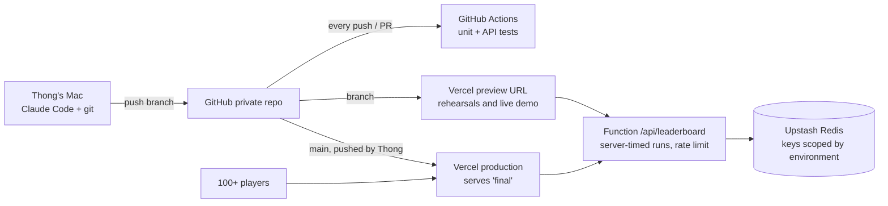

# Cờ Lau Đi — Deployment Plan

| Item | Detail |
| --- | --- |
| Updated | 13 Oct 2026, after the red-team review ([08](08-red-team-review.md)) |
| Talk | Friday 16 Oct 2026 |
| Repo | `github.com/thongnguyenhuu-agilityio/colaudi` (private) |
| Hosting | Vercel Hobby (free) + Upstash Redis (free), via Vercel Git integration |
| Cost | $0 |

**One rule:** production only changes when Thong pushes `main`. Nothing is deployed on stage. Production serves the finished version (`final`) all week, so the audience's game works even if the live demo breaks. Claude Code sessions in this repo are denied `vercel --prod` and pushes to `main` (`.claude/settings.json`).

## 1. Architecture



## 2. Decisions

| Decision | Choice | Why |
| --- | --- | --- |
| Deploy method | Vercel Git integration; `main` → production, other branches → preview | No deploy step on stage; deploys are traceable to commits |
| Environments | Local (memory store) → Preview → Production | Rehearsal scores never reach the live board |
| Data isolation | One free Upstash database; keys prefixed by `VERCEL_ENV` | Implemented in `api/leaderboard.js` |
| Anti-forgery | Server records each run's start and measures the time; minimum run `MIN_RUN_SEC` (default 45 s); 40 POSTs per IP per 10 min; GET with query string refused | Time decides the winner when many players score 36 |
| Secrets | `EVENT_CODE` in Production; `ADMIN_KEY` in Production and Preview; Redis credentials injected by the Marketplace integration | Nothing secret in git or on command lines |
| Organiser tools | `npm run board -- <url> top / wipe / rm "<name>" / close / open` | Moderation and closing sign-ups without a redeploy |
| CI | `.github/workflows/test.yml` runs `npm test` on every push and PR | Merge gate; Playwright stays local |
| Verification | `npm run smoke -- <url> --write` after every deploy | Checks page, API, Redis writes and anti-forgery without touching the board |
| Domain | Default `*.vercel.app` | Nothing to configure |

## 3. Timeline

| Day | Work | Owner | Done when |
| --- | --- | --- | --- |
| **Tue 13 Oct** | Section 4: first commit, push, Vercel project, Redis, secrets, smoke test, tag `final`. Check the push was not "Blocked" (red-team H5) | Thong runs commands; Claude verifies | Smoke test passes on production |
| **Wed 14 Oct** | Build `cp0` (scoring rule stubbed, its tests removed). Dry run 1 of the live demo; tag `cp1`–`cp3`; record a backup video; set `MIN_RUN_SEC` from the fastest honest run. Slides | Claude + Thong | Four tags; video; slides approved |
| **Thu 15 Oct** | Dry run 2: full 30 minutes through relay room B; open production from the office network and VPN. Hand the co-host kit (section 6). Wipe the board | Thong + co-host + relay operator | Under 30 min; `vercel.app` reachable from the office |
| **Fri 16 Oct** | Event-day checklist (section 6), then the talk | Thong + co-host | Talk done; top 3 checked and announced |
| **Sat 17 Oct** | Teardown (section 7) | Claude + Thong | Nothing live |

## 4. First deployment (Tue 13 Oct)

Run in Terminal on the Mac, from `~/p-webs/p-colaudi`.

**Step 1. Install, test** (Node 22: Playwright 1.47.2 hangs on newer Node)

```bash
npm ci
npm test
npx playwright install chromium && npm run test:e2e
```

**Step 2. First commit and push**

Use the git email of the account that owns the Vercel project (red-team H5).

```bash
git add -A
git commit -m "feat: Cờ Lau Đi game with live leaderboard"
git push -u origin main
```

**Step 3. Vercel project and Git connection**

```bash
vercel link                 # create a new project named "colaudi"
vercel git connect --yes
```

**Step 4. Redis.** Vercel dashboard → **colaudi → Storage → Create Database → Upstash for Redis → Free**, connected to **all environments**.

**Step 5. Secrets**

```bash
vercel env add EVENT_CODE production   # e.g. HoaLu968; shown only in Meet
vercel env add ADMIN_KEY production    # long random string
vercel env add ADMIN_KEY preview
```

**Step 6. Redeploy production with the variables.** In the Vercel dashboard, open the latest production deployment → **Redeploy**. If the Git deploy shows "Blocked", run `vercel --prod` in your own terminal instead.

**Step 7. Smoke test**

```bash
EVENT_CODE=<code> npm run smoke -- https://<production-url> --write
```

Every line must say `PASS`, including `store=redis env=production`.

**Step 8. Tag**

```bash
git tag final && git push --tags
```

## 5. Live demo flow (Fri 16 Oct)

| Stage | What happens | Fallback |
| --- | --- | --- |
| Start | `git checkout -B demo cp0`. `cp0` is the finished game with the scoring rule stubbed (`pointsFor` returns 0) and its tests removed | — |
| BA (3 min) | Claude turns the client email into `docs/stories/leaderboard.md`; commit | `git checkout cp1` |
| Dev (7 min) | Plan mode on the story; Claude writes `tests/score.test.js` first, then `pointsFor`; `npm test` green; commit | `git checkout cp2` |
| QA (4 min) | Claude writes Playwright tests from the acceptance criteria; `npm run test:e2e` green; commit | `git checkout cp3` |
| Release (2 min) | `git push origin demo` → GitHub Actions runs, Vercel builds a preview URL. Say: "in a real project this merges after review". Then post the **production** link and event code in Meet chat | Production already serves `final` |

## 6. Event day (Fri 16 Oct)

**Co-host kit** (handed over on Thu 15 Oct): production URL, event code, `ADMIN_KEY` (in a password manager, not chat), backup video link, and the commands below.

**Morning checklist**

- [ ] `git pull && npm ci && npm test`
- [ ] `export ADMIN_KEY=…` then `npm run board -- <prod-url> wipe`
- [ ] `npm run smoke -- <prod-url> --write`
- [ ] `git checkout -B demo cp0`
- [ ] Open the game with `?presenter` for the full shortcut list
- [ ] Warm up Claude Code with one throwaway prompt
- [ ] Tabs in order: game (production, `?presenter`), slides, Claude app, terminal, Upstash console
- [ ] Network cable in; phone hotspot ready

**During the talk (co-host)**

| Time | Action |
| --- | --- |
| 25:00 | `npm run board -- <prod-url> wipe`, then paste link and event code into Meet chat |
| 30:00–35:00 | Watch `npm run board -- <prod-url> top`; remove bad names with `rm "<name>"` |
| 57:00 | Check the top 3 look plausible (times, names) before the presenter announces them |
| 60:00 | `npm run board -- <prod-url> close` |

## 7. Teardown (Sat 17 Oct)

1. `npm run board -- <prod-url> top` and save the output.
2. `npm run board -- <prod-url> close` if not done already.
3. Delete the Upstash database and the Vercel project, or keep both if the game will be reused.
4. Keep the GitHub repo as a reference sample.

## 8. Risks

| Risk | Fallback |
| --- | --- |
| Git deploy "Blocked" on Vercel Hobby (private repo, author or co-author rules) | Commit with the owner's email; or `vercel --prod` from Thong's terminal |
| Company network blocks `vercel.app` | Tested Thu 15 Oct; Cloudflare Workers as fallback |
| Redis or network blip during play | Page shows "Mất kết nối, đang thử lại…"; submits fail visibly and can be retried; nothing is faked |
| Forged scores | Server-side timing and rate limit; co-host checks top 3 |
| Preview URLs ask for a Vercel login | Expected; only Thong opens previews. The audience uses production |
| Free Upstash database removed for inactivity | Created Tue 13 Oct and used in every rehearsal |
